# Physiological Stress Detection Using Machine Learning and a Simulated Wearable Device

> Thematic Seminar Project for the **Applied Computing in Healthcare** course.

## Overview

This project implements a healthcare-oriented prototype for **physiological stress detection** using Machine Learning and a simulated wearable device.

The system is designed to classify physiological patterns into two classes:

- **Stress**
- **No Stress**

The project combines two main course requirements:

1. **Artificial Intelligence / Data Science**
   - Physiological signal processing
   - Feature extraction
   - Machine Learning model training
   - Model evaluation
   - Real-time inference

2. **IoT / Wearable Simulation**
   - Simulated wearable data stream
   - Sequential physiological measurements
   - Real-time data buffering
   - Integration with the trained ML model
   - Monitoring dashboard

The project uses the **WESAD (Wearable Stress and Affect Detection)** dataset as the main source of physiological data.

---

## Academic Context

This repository was developed for the **Applied Computing in Healthcare** course as part of the **Thematic Seminar Group Project**.

The objective of the assignment is to design and build a functional healthcare application that integrates:

- an **AI / Data Science component**;
- an **IoT / wearable-device component**;
- a real digital-health use case;
- optional healthcare interoperability standards such as **HL7 FHIR**;
- privacy and ethical considerations related to health data.

The project is organized around the theme:

> **Physiological Stress Detection Using Machine Learning and a Simulated Wearable Device**

The system is intended as an **academic prototype** and not as a medical diagnostic tool. The prototype must not be used for medical diagnosis, treatment decisions, or emergency healthcare monitoring.

---

## Project Objective

The main objective is to develop a system capable of identifying physiological patterns associated with stress using signals obtained from wearable devices.

The prototype uses physiological data from WESAD to:

1. train and evaluate a Machine Learning classifier;
2. export a trained inference pipeline;
3. select a small physiological sequence for demonstration;
4. replay that sequence as if it were being collected by a wearable device;
5. send the simulated measurements to a backend;
6. create temporal windows from incoming data;
7. extract the same features used during training;
8. classify each window as **Stress** or **No Stress**;
9. display the current measurements and predictions in a monitoring dashboard;
10. optionally represent measurements or predictions using **HL7 FHIR**.

---

## High-Level Architecture

The project is divided into two main pipelines:

- **Offline Machine Learning Pipeline** — executed in Google Colab.
- **Online Application Pipeline** — executed locally.

```mermaid
flowchart LR
    subgraph COLAB["Offline ML Pipeline — Google Colab"]
        WESAD["WESAD Dataset"]
        LOAD["Data Loading & Exploration"]
        SELECT["Signal Selection & Label Definition"]
        PRE["Preprocessing"]
        WIN["Windowing"]
        FEAT["Feature Extraction"]
        TRAIN["Model Training & Evaluation"]
        FINAL["Final Model Selection"]
        EXPORT["Export Artifacts"]

        MODEL["stress_pipeline.joblib"]
        DEMO["demo_stream.csv"]

        WESAD --> LOAD
        LOAD --> SELECT
        SELECT --> PRE
        PRE --> WIN
        WIN --> FEAT
        FEAT --> TRAIN
        TRAIN --> FINAL
        FINAL --> EXPORT
        EXPORT --> MODEL
        EXPORT --> DEMO
    end

    subgraph APP["Online Application — Local / VS Code"]
        SIM["Wearable Simulator"]
        API["FastAPI Backend"]
        BUFFER["Real-Time Buffer / Window"]
        ONLINE_FEAT["Shared Feature Extraction"]
        INFERENCE["Model Inference"]
        PRED["Stress / No Stress"]
        DASH["Streamlit Dashboard"]
        FHIR["FHIR JSON / Observation"]

        SIM --> API
        API --> BUFFER
        BUFFER --> ONLINE_FEAT
        ONLINE_FEAT --> INFERENCE
        INFERENCE --> PRED
        PRED --> DASH
        PRED --> FHIR
    end

    DEMO --> SIM
    MODEL --> INFERENCE
```



---

## Pipeline Separation

### Offline Pipeline — Google Colab

The offline pipeline is responsible for **building and validating the Machine Learning model**.

It operates on historical WESAD data and performs the computationally heavier stages of the project.

Main responsibilities:

- access the WESAD dataset;
- load participant data;
- inspect physiological signals;
- define the selected signals;
- define `Stress` and `No Stress` labels;
- preprocess the raw signals;
- synchronize/resample signals when necessary;
- segment signals into temporal windows;
- extract features;
- construct the Machine Learning dataset;
- define train/validation/test splits;
- train candidate models;
- evaluate model performance;
- select the final classifier;
- export the trained inference artifact;
- generate a small demo data stream.

The Colab notebook finishes by producing:

```text
stress_pipeline.joblib
demo_stream.csv
```

These artifacts are then added to the repository and used by the online application.

---

### Online Pipeline — Local Application

The online application is responsible for **simulating wearable data acquisition and performing inference**.

It does not train the model and does not need the complete WESAD dataset.

The application only uses:

- the trained model artifact;
- a small demo stream;
- the shared feature-extraction logic.

The runtime flow is:

```text
demo_stream.csv
        ↓
Wearable Simulator
        ↓
HTTP measurements
        ↓
FastAPI Backend
        ↓
Real-Time Buffer
        ↓
Feature Extraction
        ↓
stress_pipeline.joblib
        ↓
Stress / No Stress
        ↓
Streamlit Dashboard
        ↓
Optional FHIR representation
```

---

## Main Components

### 1. WESAD Dataset

The project uses **WESAD — Wearable Stress and Affect Detection** as the physiological data source.

The dataset contains wearable signals recorded under different experimental conditions, including stress-related conditions.

Possible signals used by the project include:

- EDA — Electrodermal Activity;
- BVP — Blood Volume Pulse;
- skin temperature;
- accelerometer data;
- derived heart-rate information.

The final signal selection should remain consistent between:

- training;
- feature extraction;
- simulated wearable data;
- online inference.

The complete WESAD dataset should **not** be stored in this GitHub repository.

---

### 2. Google Colab Notebook

The notebook contains the complete offline Data Science workflow.

Expected modules:

1. Project and Data-Science Scope
2. Environment and Reproducibility
3. WESAD Dataset Access
4. Dataset Loading
5. Exploratory Data Analysis
6. Signal Selection
7. Label Definition
8. Signal Preprocessing
9. Temporal Windowing
10. Feature Engineering
11. Machine Learning Dataset Construction
12. Train / Validation / Test Strategy
13. Candidate Model Definition
14. Model Training
15. Model Evaluation
16. Final Model Selection
17. Final Inference Pipeline Definition
18. Model Export
19. Demo Data Selection
20. Demo Stream Preparation
21. Demo Data Export
22. Artifact Validation
23. Final Notebook Outputs
24. Machine Learning Results Summary

The notebook should be reproducible and document the assumptions made during model development.

---

### 3. `stress_pipeline.joblib`

This file is the trained Machine Learning artifact generated by the Colab notebook.

It is loaded by the backend when the application starts.

Its purpose is to provide inference without retraining the model.

Conceptually:

```text
Feature Vector
      ↓
Trained Pipeline
      ↓
Stress / No Stress
```

Whenever possible, transformations such as scaling should be included inside the exported Scikit-learn pipeline.

---

### 4. `demo_stream.csv`

This file contains a **small chronological physiological sequence** extracted from the original dataset.

It is used exclusively for the simulated wearable demo.

The file should contain only the information required by the runtime application.

Example conceptual structure:

```text
timestamp,heart_rate,eda,temperature,acceleration,reference_label
0,72,1.21,35.8,0.13,no_stress
1,73,1.24,35.8,0.15,no_stress
...
120,93,3.52,35.6,0.27,stress
```

The reference label can be retained for evaluation or demonstration purposes but should not be passed to the classifier as an input feature.

---

### 5. Wearable Simulator

The wearable simulator represents the IoT component of the project.

Its responsibilities are intentionally simple:

- read `demo_stream.csv`;
- preserve chronological order;
- generate one measurement at a time;
- simulate a configurable interval between measurements;
- send measurements to the backend via HTTP.

Conceptually:

```text
demo_stream.csv
        ↓
read next measurement
        ↓
send to backend
        ↓
wait
        ↓
repeat
```

This simulates a wearable device continuously transmitting physiological data.

---

### 6. FastAPI Backend

The backend is the integration layer between the wearable simulator, the Machine Learning model, and the dashboard.

Its main responsibilities are:

- receive measurements from the simulator;
- validate incoming data;
- maintain a real-time measurement buffer;
- determine when a complete analysis window is available;
- call the shared feature-extraction logic;
- load and use `stress_pipeline.joblib`;
- generate stress predictions;
- expose the latest monitoring state;
- expose recent prediction history;
- optionally generate FHIR-compatible JSON.

The backend **does not train the model**.

The model should be loaded once when the backend starts and kept in memory.

---

## Suggested API Endpoints

A minimal API is enough for this project.

### `POST /measurements`

Receives a physiological measurement from the simulated wearable.

Example conceptual payload:

```json
{
  "timestamp": 42,
  "heart_rate": 91,
  "eda": 3.2,
  "temperature": 35.6,
  "acceleration": 0.23
}
```

### `GET /status`

Returns the latest monitoring state.

Possible information:

- latest physiological measurement;
- current prediction;
- confidence/probability;
- buffer progress;
- prediction timestamp.

### `GET /history`

Returns recent measurements and predictions for dashboard visualization.

### `GET /fhir/latest`

Optional endpoint returning the latest monitoring result as an HL7 FHIR-compatible representation.

---

### 7. Shared Feature Extraction

Training-time and inference-time feature extraction must remain consistent.

For example, if the model is trained using:

```text
heart_rate_mean
heart_rate_std
eda_mean
eda_std
temperature_mean
acceleration_mean
```

the backend must calculate the exact same features from each real-time window.

To avoid duplicated logic, shared feature extraction should be isolated into a reusable Python module.

```text
                  feature_extraction.py
                       /          \
                      /            \
                 Colab            Backend
                   ↓                 ↓
              Training          Inference
```

This reduces the risk of **training-serving skew**.

---

### 8. Streamlit Dashboard

The dashboard is responsible only for visualization.

It should not train or directly execute the ML model.

The dashboard retrieves monitoring information from the backend and displays it to the user.

Possible interface elements:

- current heart rate;
- current EDA;
- current temperature;
- activity/acceleration;
- current stress classification;
- model confidence;
- recent signal plots;
- prediction history.

Example:

```text
Physiological Stress Monitoring

Heart Rate        91 bpm
EDA               3.20
Temperature       35.6 °C

Current state

        STRESS

Confidence: 87%

Recent Predictions
------------------
12:01  No Stress
12:02  No Stress
12:03  Stress
```

---

### 9. FHIR Interoperability

FHIR support is an optional quality extension for the project.

The system may represent physiological measurements or stress-classification results using an HL7 FHIR `Observation` resource.

The prototype does not require a complete FHIR server.

A simple generated JSON representation is sufficient to demonstrate how the data could be integrated with external healthcare systems.

---

## Suggested Repository Structure

```text
physiological-stress-detection/
│
├── README.md
├── requirements.txt
├── .gitignore
│
├── notebooks/
│   └── WESAD_Stress_Detection_Offline_ML_Pipeline.ipynb
│
├── data/
│   └── demo_stream.csv
│
├── model/
│   └── stress_pipeline.joblib
│
├── shared/
│   ├── __init__.py
│   └── feature_extraction.py
│
├── simulator/
│   ├── __init__.py
│   └── simulator.py
│
├── backend/
│   ├── __init__.py
│   ├── main.py
│   ├── schemas.py
│   ├── model_service.py
│   ├── monitoring_service.py
│   └── fhir_service.py
│
├── dashboard/
│   └── app.py
│
├── docs/
│   └── architecture.png
│
└── tests/
    ├── test_features.py
    └── test_backend.py
```

---

## Folder Responsibilities

### `notebooks/`

Contains the Google Colab / Jupyter notebook used for:

- dataset exploration;
- preprocessing;
- model development;
- evaluation;
- export of final artifacts.

---

### `data/`

Contains only small files required by the runtime application.

The complete WESAD dataset should not be committed.

Expected file:

```text
demo_stream.csv
```

---

### `model/`

Contains the trained inference artifact generated by the notebook.

Expected file:

```text
stress_pipeline.joblib
```

---

### `shared/`

Contains logic shared between model development and online inference.

Main responsibility:

```text
feature_extraction.py
```

This module guarantees consistency between offline training and online prediction.

---

### `simulator/`

Contains the simulated wearable component.

Responsibilities:

- replay physiological data;
- simulate streaming;
- communicate with the backend.

---

### `backend/`

Contains the FastAPI application.

Suggested files:

#### `main.py`

- FastAPI application entry point;
- API routes;
- startup logic.

#### `schemas.py`

- request/response structures;
- physiological measurement schema;
- prediction schema.

#### `model_service.py`

- load the trained model;
- execute inference;
- expose prediction utilities.

#### `monitoring_service.py`

- maintain the real-time buffer;
- create analysis windows;
- maintain current monitoring state;
- maintain recent history.

#### `fhir_service.py`

- convert relevant results to FHIR-compatible JSON.

---

### `dashboard/`

Contains the Streamlit monitoring interface.

Expected file:

```text
app.py
```

---

### `docs/`

Contains project documentation and architecture diagrams.

---

### `tests/`

Contains lightweight tests for critical logic.

Suggested priorities:

- feature extraction consistency;
- model input format;
- backend measurement validation.

---

## Technology Stack

| Component | Technology |
|---|---|
| Dataset | WESAD |
| Data processing | Python, NumPy, Pandas |
| Machine Learning | Scikit-learn |
| Offline development | Google Colab |
| Model serialization | Joblib |
| Wearable simulation | Python |
| Communication | HTTP |
| Backend | FastAPI |
| Dashboard | Streamlit |
| Interoperability | HL7 FHIR JSON |
| Version control | Git / GitHub |

The project intentionally avoids unnecessary infrastructure in order to keep the academic prototype understandable and maintainable.

---

## Development Workflow

### Phase 1 — Machine Learning

Run the notebook in Google Colab.

```text
WESAD
  ↓
Preprocessing
  ↓
Windowing
  ↓
Feature Extraction
  ↓
Model Training
  ↓
Evaluation
  ↓
Export
```

Outputs:

```text
stress_pipeline.joblib
demo_stream.csv
```

---

### Phase 2 — Artifact Handoff

Copy the exported files into:

```text
model/stress_pipeline.joblib
data/demo_stream.csv
```

This handoff is intentionally manual for the academic prototype.

No model registry or automated deployment pipeline is required.

---

### Phase 3 — Online Application

Start the backend.

```bash
uvicorn backend.main:app --reload
```

Start the dashboard.

```bash
streamlit run dashboard/app.py
```

Start the simulated wearable.

```bash
python simulator/simulator.py
```

The complete live flow becomes:

```text
Wearable Simulator
        ↓
FastAPI Backend
        ↓
Feature Extraction
        ↓
ML Inference
        ↓
Stress / No Stress
        ↓
Streamlit Dashboard
```

---

## Installation

Clone the repository:

```bash
git clone <repository-url>
cd physiological-stress-detection
```

Create and activate a virtual environment.

### Windows

```bash
python -m venv .venv
.venv\Scripts\activate
```

### Linux / macOS

```bash
python -m venv .venv
source .venv/bin/activate
```

Install dependencies:

```bash
pip install -r requirements.txt
```

---

## Running the Demo

The expected execution order is:

### 1. Start the backend

```bash
uvicorn backend.main:app --reload
```

### 2. Start the dashboard

```bash
streamlit run dashboard/app.py
```

### 3. Start the wearable simulator

```bash
python simulator/simulator.py
```

The simulator begins sending measurements to the backend.

The backend forms temporal windows and performs model inference.

The dashboard displays incoming physiological information and the current stress prediction.

---

## Model Evaluation

The final report should document the evaluation of the AI component.

Suggested metrics:

- Accuracy
- Precision
- Recall
- F1-score
- Confusion Matrix

Because the dataset contains multiple participants, the evaluation strategy should minimize participant leakage between training and testing whenever possible.

The exact results will be added after model development.

---

## Privacy and Ethical Considerations

Physiological information can be considered sensitive health-related data.

A real-world implementation should consider:

- informed consent;
- access control;
- secure transmission;
- secure storage;
- data minimization;
- anonymization or pseudonymization;
- LGPD requirements;
- HIPAA requirements where applicable.

The project uses an existing public research dataset and a simulated wearable rather than collecting new participant data.

---

## Clinical Interpretation

This project is a Machine Learning prototype and **does not provide a clinical diagnosis of stress**.

Physiological signals can be affected by many factors, including:

- physical activity;
- temperature;
- caffeine;
- medication;
- illness;
- individual physiological differences.

Therefore, the classification should be interpreted as:

> a physiological pattern classified by the model as being associated with the `Stress` or `No Stress` class defined by the dataset.

The system should not be used as a substitute for professional clinical assessment.

---

## Current Scope

The intended project scope includes:

- binary stress classification;
- WESAD physiological data;
- offline ML development in Google Colab;
- trained model export;
- simulated wearable;
- HTTP communication;
- FastAPI inference backend;
- Streamlit monitoring interface;
- optional FHIR representation.

---

## Limitations

Expected limitations include:

- limited number of WESAD participants;
- controlled experimental conditions;
- inter-person physiological variation;
- simulated rather than physical IoT hardware;
- binary classification;
- possible differences between laboratory stress and real-world stress;
- dependence on the selected preprocessing and feature-engineering strategy.

---

## Team Responsibilities

A possible three-person task division is:

### Data Science / Machine Learning

Responsible for:

- WESAD;
- preprocessing;
- feature extraction;
- model training;
- model evaluation;
- export of `stress_pipeline.joblib`;
- generation of `demo_stream.csv`.

### IoT / Wearable Simulation

Responsible for:

- simulator design;
- sequential data replay;
- HTTP transmission;
- demo-stream integration;
- testing simulated acquisition behavior.

### Application Integration

Responsible for:

- FastAPI backend;
- real-time buffer;
- model integration;
- Streamlit dashboard;
- FHIR representation;
- end-to-end integration.

All team members should understand the complete architecture and be able to explain the entire system during the seminar Q&A.

---

## Course Deliverables

### Mid-Term Seminar

The architecture and project plan should cover:

- healthcare problem;
- clinical relevance;
- target users;
- system architecture;
- AI component;
- IoT/wearable component;
- data source;
- technology stack;
- risks;
- task division.

### Final Seminar

The final project should include:

- live application demo;
- code walkthrough;
- public/shared GitHub repository;
- setup documentation;
- Machine Learning evaluation;
- IoT/wearable pipeline explanation;
- interoperability discussion;
- privacy and ethical considerations;
- limitations and future work.

---

## Repository Status

This repository is developed incrementally as part of the course project.

Current development stages:

- [ ] WESAD data exploration
- [ ] Signal selection
- [ ] Preprocessing
- [ ] Windowing
- [ ] Feature extraction
- [ ] ML model training
- [ ] ML model evaluation
- [ ] Model export
- [ ] Demo stream generation
- [ ] Wearable simulator
- [ ] FastAPI backend
- [ ] Real-time inference
- [ ] Streamlit dashboard
- [ ] FHIR representation
- [ ] End-to-end demo
- [ ] Final documentation


